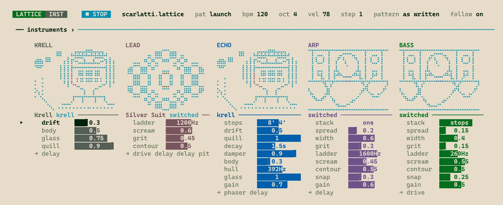

I've been thinking a lot about what software development means in the age of agentic programming.
The trigger was the recent shock when someone reverse-engineered and re-implemented the
Adobe suite: Photoshop, Illustrator and the rest. What surprised people on social media was how usable it is, for
software that complex. To me that was inevitable, given how LLMs have developed, though I only really realised it
this year, from the start of 2026. The quality of the code and the autonomy of the agents mean you can now generate
excellent software without much human intervention, and it's going to keep getting better for a good while yet.

So what is software now?

## Software that isn't for me

For most of my adult life I've been dissatisfied with the software I'm forced to use, and it has kept getting worse.
I'm not the customer it's built for. Windows is like that, and the Mac is maybe even more extreme: you do it the Mac way,
you buy into the whole ecosystem of phones and cloud, or nothing "just works". If your mental model doesn't fit the OS,
you feel constant friction.

Updates make it worse. At best, something you're used to moves and it's jarring. At worst, a way you used to work
effectively stops being possible. Software as a service compounded all of this, because you can no longer just stay
on the version you like.

So software keeps getting worse, at the same time as we now have technology that lets us write good, performant,
environment-aware software from scratch. Where does that leave us?

## Starting with my operating system

It started with Windows updates breaking my Wi-Fi adapter. That happened on my laptop, and to other people in my lab
who use the same model of laptop. WSL2 had taken away a lot of my itch to move to Linux (I'd done it a
couple of times before, mainly for work), and I'd stayed on Windows mostly for Office and gaming. But
updates kept breaking things, customisation kept shrinking, features I used were taken away and adverts were crammed
in.

Meanwhile, I'd been managing the Linux machines my lab uses, and agents had been making that a pleasure for a while. Hand one an error
message or the startup logs and it searches 10,000 lines of output and finds the problem. Linux stopped being
daunting. I love Linux and I'm competent on the command line, but when I want to write a grant, answer email, make music or play games, I
need the computer to work. I enjoy some tinkering, but I don't want it to be all I do with my spare time. For some
people Linux is their hobby; I didn't want it to be mine.

I'd been interested in NixOS for a long time, but I could never get started with
Nix. So the first test was whether an agent could write my Nix config. It could. I ran it on a personal machine at
home and it was a great success. It worked so well because the whole system configuration, dotfiles included (through Home Manager), is described in
one repository, so the agent has visibility over everything and tweaking anything is easy.

Then I made the jump. Software development already worked without friction on Linux; I just needed papers, grants
and presentations to as well. I switched my main work laptop to NixOS and spent a couple of days setting it up,
mostly by choice rather than necessity. Development worked straight away; everything else followed.

Then came the long tail of tinkering, and that's a triumph, not a criticism. I use Hyprland as my tiling window
manager, with Rofi menus and Waybar to start with. With the whole config in one place, the agent could add Waybar
widgets (my VPN connection, reminders and so on), so I started fixing the small friction points systematically. Then
the bigger ones: syncing work files without a Windows machine, and crashes when plugging into projectors, which I do
all the time for work. Now I have scripts behind little visual widgets, and plugging in mostly just works.

It got more ambitious from there. I moved the whole interface to Quickshell, with custom widgets, menus, system monitors and
cloud storage management, all tuned to what I want and how I like it to look. For example, Stylix in Nix derives a
colour palette from an image. Now, when I change my wallpaper, a neural network derives a palette that themes the
whole Quickshell UI, optimised for my protanopia, so I can tell the colours apart as well as possible. Underneath, it's
software I like (kitty for the terminal and so on), heavily customised and sometimes patched to fix what irritates me
or to fit my setup.

Over time it's become hyper-optimised: automated transcription that picks up recordings from my phone and writes
them into my markdown notes, password-manager widgets, and lots of small things that make life slightly easier.

## Whole projects

Then you realise the power for whole projects. Not code completion, not individual functions, but: "here's a project
I want to design from scratch, and here are my lofty ambitions." I'd done this for work, but the scope was narrower
than it could have been, because I hadn't realised how good agents are at architecting and engineering software.

## Lattice

Lattice is the most recent example, and the reason for this post. It's a keyboard-driven audio tracker that lives in
the terminal, and I am in love with it:

```
 LATTICE  PATTERN   ■ STOP    mountain-king.lattice   pat march   bpm 138   oct 4   vel 78   step 1

               ╭─ TROLLS ──────────────────────────────────────────────────────────╮
    CONDUCTOR  TROLL                             BASSOON     PIZZ        DRONE       BASS        ›
               64                                64          64          64          64
               tr+12/2+1                         no rules    no rules    no rules    no rules
               ───────────────────────────────── ─────────── ─────────── ─────────── ───────────
     C                     vel g    G    cut fur
 00   ··   ··   B-3        90   ··   ··   ··  ··  ···         B-4         ···         B-1
 01   ··   ··   ···             ··   ··   ··  ··  ···         ···         ···         ···
 02   ··   ··   C#4        78   ··   ··   ··  ··  ···         C#5         ···         B-2
 03   ··   ··   ···             ··   ··   ··  ··  ···         ···         ···         ···
 04   ··   ··   D-4        78   ··   ··   ··  ··  ···         D-5         ···         B-1
 05   ··   ··   ···             ··   ··   ··  ··  ···         ···         ···         ···
 06   ··   ··   E-4        78   ··   ··   ··  ··  ···         E-5         ···         B-2
 07   ··   ··   ···             ··   ··   ··  ··  ···         ···         ···         ···
 08   ··   ··   F#4        78   ··   ··   ··  ··  ···         F#5         ···         B-1
 NORMAL                       v select · x rows · g goto · ] next · i insert · d delete · : command
```

It has a custom sample-accurate sequencer, very performant sound engines, and lots of custom effects and synth
engines. The aim is for it to be highly opinionated and optimised to what I want: in other words, it's deeply personal software.

Why a tracker? I'd used Renoise and the Polyend Tracker, and trackers mesh beautifully with how I think about music.
But they're in an uncanny valley for me. They behave almost exactly as I expect, but not quite, and that cognitive
dissonance put me off. I'd rather have no expectations and learn a tool from scratch. Renoise looks keyboard-driven
and reminded me of Vim (and of Helix, a big inspiration for Lattice), but it doesn't work like Vim. You can customise
it with modules, but that's a layer on top of someone else's ambitions, which defeats the point. Agents can now handle projects on
a totally different scale, so start from your own idea, not someone else's.

I had the shadow of a piece of software in my mind, an idea of how a tracker should work. Rather than retrofit an existing one
and patch in my sounds, plugins and art, I made it from scratch. Even a few months ago, it would have been a
preposterous notion that to make music, you start by writing your own DAW and synth engines. You'd never make any
music. That's no longer the case.

I'd worked on Lattice before, and explored a lot of good ideas, but implemented it badly; with hindsight, mainly in
how the interface was separated from the sound engine. So I kept the spirit and the aims and started again. With AI
help I quickly had a blurry version of what was in my mind, then refined it over days and weeks until it matched.

I'm not thinking about customers or a user base, just what I want, so it's mad in places. It draws on *Forbidden
Planet*, a film I love: there's a synth engine called Krell, with the Krell machine as its artwork. The sound brief
was: what if you put Domenico Scarlatti in a skin-tight silver space suit, shot him into space, and had him play a
harpsichord built from ancient alien technology? Building up effects, engines and features piece by piece, it came to
reflect that software shadow in my psyche. It feels wonderful and deeply intuitive to use, because it's exactly what
I want.

I'll release Lattice with the source available, and make videos about it.[^soon] It has excellent documentation, a good
tutorial and an in-depth manual, so it's usable by other people, and a few will find it fits their mental model of a
tracker. But it isn't for them; it's for me.

## Deeply personal software

This is what I think has happened: we've entered an age of deeply personal software, written for an audience of one.
You no longer have to put up with other people's ideas of how a computer should work. It lives up to the early vision
of the Free Software Foundation, and it's open to anyone who can get hold of a capable LLM, increasingly cheaply through
various providers or even locally on your own machine. People should use them to make deeply
personal software. It's software I love to use, it's software that I'd want my children to inherit when I die.

## The licence

That's why Lattice doesn't just use a standard open-source licence, but what I call the Deeply Personal Software
Licence. The source is available: do what you like with it, including the underlying sound engine. Change it, build
on it, sell it if you want. The restriction only covers the deeply personal parts: the name, the artwork, and
anything in my voice, like the manual. I want people to enjoy those, but not to pass them off as their own,
because then it's not deeply personal and that defeats the point. Go and make the software that **you** want to use
and make it deeply personal.

[^soon]: Lattice isn't public yet, but it's coming soon: the source, videos about it on the
    [channel](https://www.youtube.com/@mochreach), and a release you can use yourself. Here's a first look, the
    instrument page from the Scarlatti example, with Krell on the left:

    
